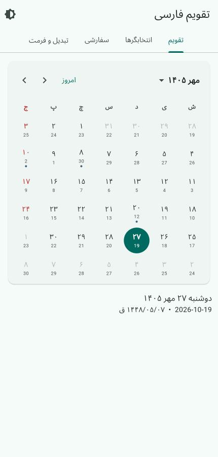
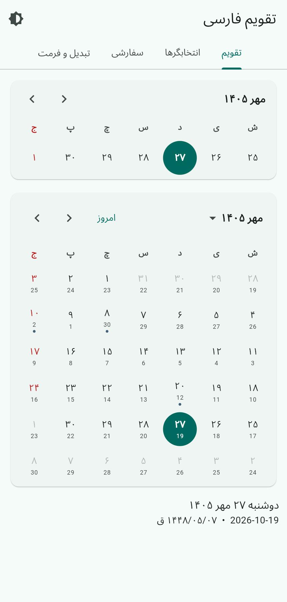
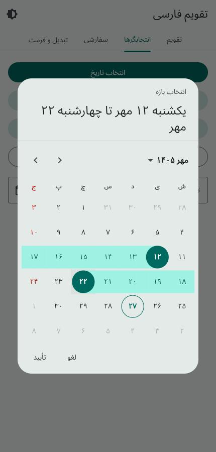
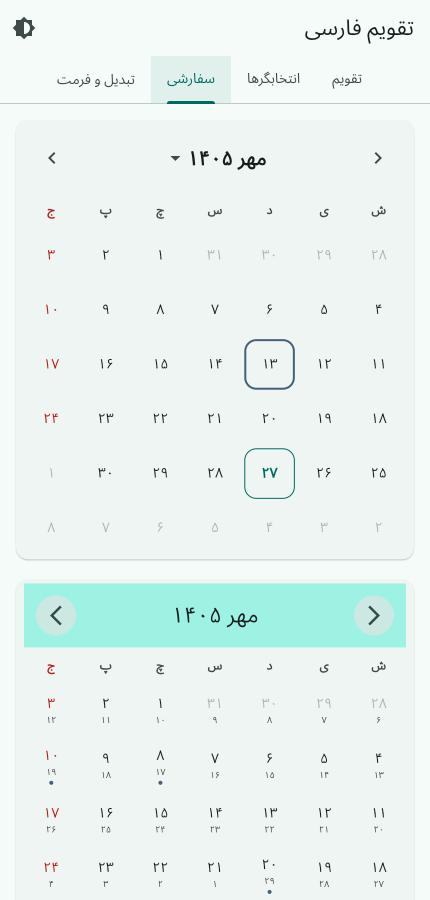
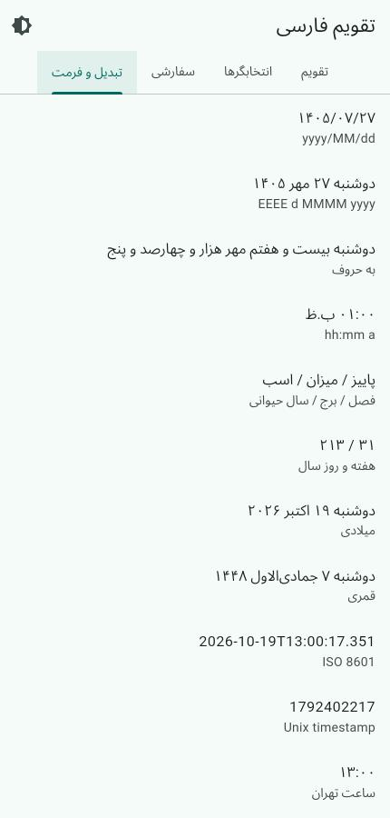
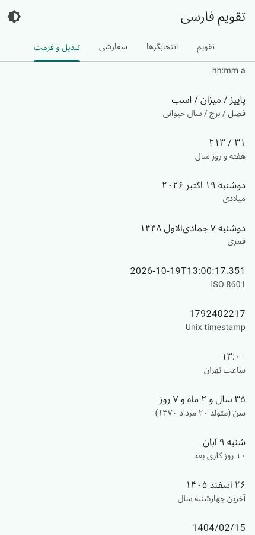

# persian_calendar_kit

A complete **Persian (Jalali / Shamsi)** calendar toolkit for Flutter.

* 📅 Accurate Jalali ⇄ Gregorian ⇄ Hijri conversion (years −61 … 3177),
  plus Unix timestamps, ISO 8601, Julian days and Tehran time
* ➕ Date arithmetic: days, months, years, durations, ranges, weeks
* 🖋 Pattern-based formatting **and parsing** for all three calendars,
  Persian / Arabic / English digits, numbers & dates in words
* 🧮 Age, periods, business days, nth weekday of month, seasons, zodiac,
  animal year, relative time and duration formatting
* 🇮🇷 Official Iranian holidays and occasions (solar + lunar), custom events
* 🧩 Widgets: calendar, week strip, month grid, date / range / multi pickers, wheel
  picker, year & month pickers, form field
* 🎨 **Fully customizable**: `ThemeExtension`, per-widget themes, builders
  for every part, swappable texts (Persian, Dari, Kurdish, English), RTL/LTR

---

## Installation

```yaml
dependencies:
  persian_calendar_kit: ^0.1.0
```

```dart
import 'package:persian_calendar_kit/persian_calendar_kit.dart';
```

## Dates

```dart
final today = JalaliDate.today();
final nowruz = JalaliDate(1404, 1, 1);

nowruz.toDateTime();              // 2025-03-21 00:00:00.000
DateTime(2025, 3, 21).toJalali(); // 1404/01/01
JalaliDate.fromGregorian(2000, 1, 1); // 1378/10/11

nowruz.weekday == JalaliDate.friday; // true
nowruz.isLeapYear;   // false
nowruz.monthLength;  // 31
nowruz.dayOfYear;    // 1
nowruz.weekOfYear;   // 1
nowruz.season;       // 1 (بهار)

nowruz.addDays(10);
nowruz.addMonths(6);           // day is clamped (31 Shahrivar + 1 → 30 Mehr)
nowruz.add(const Duration(hours: 5));
nowruz.startOfWeek();          // weeks start on Saturday
nowruz.endOfMonth;
nowruz.difference(today);

JalaliDate.parse('۱۴۰۴/۰۱/۱۵ 08:30');
JalaliDate.tryParse('1404-12-30'); // null (1404 isn't leap)
```

### Formatting

```dart
nowruz.format('EEEE d MMMM yyyy');  // جمعه ۱ فروردین ۱۴۰۴
nowruz.format('yyyy/MM/dd');        // ۱۴۰۴/۰۱/۰۱
nowruz.format('dddd MMMM');         // یکم فروردین
nowruz.format("'فصل' QQQQ");        // فصل بهار
nowruz.format('d MMMM yyyy', strings: PersianCalendarStrings.english);
// 1 Farvardin 1404
nowruz.format('MMMM', strings: PersianCalendarStrings.dari); // حمل
```

| Token | Meaning | Token | Meaning |
|---|---|---|---|
| `yyyy` `yy` `y` | year | `EEEE` / `E` | weekday / short weekday |
| `MMMM` `MM` `M` | month name / number | `QQQQ` / `Q` | season name / number |
| `dddd` `dd` `d` | ordinal day / day | `D` / `w` | day of year / week of year |
| `HH` `H` `hh` `h` | hour (24h / 12h) | `mm` `ss` `SSS` | minute / second / ms |
| `a` | ق.ظ / ب.ظ | `'text'` | literal text |

### Digits & relative time

```dart
PersianDigits.toPersian('1404/01/15');   // ۱۴۰۴/۰۱/۱۵
PersianDigits.toEnglish('۱۴۰۴');         // 1404
PersianDigits.withSeparators(1250000);   // ۱٬۲۵۰٬۰۰۰
'12'.toPersianDigits;                    // ۱۲
PersianRelativeTime.format(date);        // ۳ روز پیش / فردا / ۲ ساعت دیگر
```

### Hijri & Gregorian

```dart
nowruz.toHijri();     // 1446/09/21
nowruz.toGregorian(); // 2025-03-21
JalaliDate.fromHijri(HijriDate(1446, 10, 1)); // 1404/01/11

// Hijri dates use the tabular Islamic calendar. Align with the official
// (moon-sighting based) calendar when needed:
HijriDate.adjustment = -1;
```

## Every conversion

```dart
// Between calendars (plain records)
CalendarConverter.gregorianToJalali(2025, 3, 21); // (year: 1404, month: 1, day: 1)
CalendarConverter.jalaliToHijri(1404, 1, 11);     // (year: 1446, month: 10, day: 1)
CalendarConverter.hijriToGregorian(1446, 10, 1);  // (year: 2025, month: 3, day: 31)

// Objects
JalaliDate(1404, 1, 1).toGregorian();  // GregorianDate 2025-03-21
JalaliDate(1404, 1, 1).toHijri();      // HijriDate 1446/09/21
GregorianDate(2025, 3, 21).toJalali(); // 1404/01/01
HijriDate(1446, 10, 1).toJalali();     // 1404/01/11

// Timestamps, ISO 8601, time zones
JalaliDate.fromSecondsSinceEpoch(1742500000);
JalaliDate.fromMillisecondsSinceEpoch(ms, isUtc: true);
date.secondsSinceEpoch();
JalaliDate.fromIso8601('2025-03-21T08:30:00Z');
date.toIso8601String();
JalaliDate.nowInTehran();                       // UTC+03:30
JalaliDate.nowAt(const Duration(hours: 4, minutes: 30)); // any offset
```

### Words

```dart
PersianNumberWords.convert(1404);  // هزار و چهارصد و چهار
PersianNumberWords.ordinal(23);    // بیست و سوم
JalaliDate(1404, 1, 15).toWords(); // پانزدهم فروردین هزار و چهارصد و چهار
date.format('dddd MMMM Y');        // یکم فروردین هزار و چهارصد و چهار
```

### Parsing with patterns

```dart
JalaliFormatter('d MMMM yyyy').parse('۱۵ فروردین ۱۴۰۴');
JalaliFormatter('d MMMM yyyy').parse('1 Ordibehesht 1404'); // any language
JalaliFormatter('d MMMM yyyy').parse('۱ حمل ۱۴۰۴');         // Dari names
JalaliFormatter('yyyy/MM/dd hh:mm a').parse('1404/01/15 08:30 ب.ظ');
HijriDate.tryParse('۱ شوال ۱۴۴۶', pattern: 'd MMMM yyyy');
GregorianDate.tryParse('21 March 2025', pattern: 'd MMMM yyyy');
```

Arabic `ي`/`ك`, Persian / Arabic digits and extra spaces are normalized
automatically. Hijri and Gregorian dates have `format()` too:

```dart
HijriDate(1446, 10, 1).format('d MMMM yyyy');            // ۱ شوال ۱۴۴۶
GregorianDate(2025, 3, 21).format('EEEE d MMMM yyyy');   // جمعه ۲۱ مارس ۲۰۲۵
```

## Date utilities

```dart
final birth = JalaliDate(1370, 5, 20);
birth.age().format();       // ۳۳ سال و ۷ ماه و ۱۱ روز
birth.ageInYears();
birth.nextAnniversary();
JalaliPeriod.between(a, b); // years / months / days

final events = IranianCalendarEvents();
date.isHoliday(events: events);
date.isBusinessDay(events: events);
date.addBusinessDays(10, events: events);
start.businessDaysUntil(end, events: events);

date.next(JalaliDate.friday);
date.previous(JalaliDate.saturday);
JalaliCalendar.nthWeekdayOfMonth(1403, 12, JalaliDate.wednesday, -1); // last
JalaliCalendar.monthMatrix(1404, 1);     // weeks × 7 days, for custom grids
JalaliCalendar.daysOfMonth(1404, 1);
JalaliCalendar.leapYearsBetween(1390, 1410);

date.startOfSeason; date.endOfSeason;
date.zodiacSign;   // حمل
date.animalYear;   // مار
date.timeAgo();    // ۳ روز پیش
PersianDurationFormat.format(const Duration(hours: 26)); // ۱ روز و ۲ ساعت
PersianDurationFormat.clock(const Duration(minutes: 125)); // ۰۲:۰۵:۰۰
```
## Events & holidays

```dart
final events = IranianCalendarEvents(); // official holidays + occasions
events.eventsOn(JalaliDate(1404, 1, 1)); // [عید نوروز, آغاز سال نو]
events.isHoliday(JalaliDate(1404, 11, 22)); // true

// Your own events, with rules:
const myEvents = RuleBasedEventProvider([
  CalendarEventDefinition(SolarEventRule(5, 20), CalendarEvent(title: 'تولد')),
  CalendarEventDefinition(HijriEventRule(9, 1), CalendarEvent(title: 'رمضان')),
  CalendarEventDefinition(GregorianEventRule(1, 1), CalendarEvent(title: 'New year')),
]);

// ...or from a callback / database:
final fromDb = CallbackEventProvider((date) => myRepo.eventsOn(date));

final all = events.merge(myEvents).merge(fromDb);
```

## Widgets

### Calendar

```dart
PersianCalendar(
  options: PersianCalendarOptions(
    eventProvider: IranianCalendarEvents(),
    secondaryCalendar: SecondaryCalendar.gregorian,
    minDate: JalaliDate(1400),
    maxDate: JalaliDate(1410, 12, 29),
  ),
  showTodayButton: true,
  onDaySelected: (date) => print(date.toLongString()),
)
```

Selection modes: `single`, `multiple`, `range`, `none`. Use a
`PersianCalendarController` to drive it from outside:

```dart
final controller = PersianCalendarController(
  selectionMode: PersianSelectionMode.range,
);

PersianCalendar(controller: controller);

controller.nextMonth();
controller.showMonth(JalaliDate(1405, 7));
controller.selectedRange; // JalaliDateRange?
```

`PersianMonthView` (a single grid), `PersianWeekdayRow`,
`PersianYearPicker` and `PersianMonthPicker` are public too, so you can
build completely different layouts.

### Week strip

```dart
PersianWeekView(
  controller: controller, // share it with a PersianCalendar
  options: PersianCalendarOptions(eventProvider: IranianCalendarEvents()),
  onDaySelected: (date) => ...,
)
```

### Pickers

```dart
final JalaliDate? date = await showPersianDatePicker(context: context);
final JalaliDateRange? range = await showPersianDateRangePicker(context: context);
final List<JalaliDate>? dates = await showPersianMultiDatePicker(context: context);
final JalaliDate? wheel = await showPersianWheelDatePicker(context: context);

PersianDateFormField(
  decoration: const InputDecoration(labelText: 'تاریخ تولد'),
  validator: (d) => d == null ? 'الزامی است' : null,
)
```

## Customization

Styling is resolved from four layers (later wins):

1. defaults derived from your `ColorScheme` / `TextTheme` (light & dark ready),
2. `ThemeData.extensions: [PersianCalendarThemeData(...)]` (app-wide),
3. a `PersianCalendarTheme` widget (subtree),
4. the `theme:` argument of a widget.

```dart
PersianCalendar(
  theme: PersianCalendarThemeData(
    dayShape: PersianDayShape.roundedRectangle,
    dayBorderRadius: BorderRadius.circular(12),
    selectedDayDecoration: BoxDecoration(
      gradient: LinearGradient(colors: [Colors.teal, Colors.blue]),
    ),
    rangeHighlightColor: Colors.teal.shade50,
    holidayTextStyle: TextStyle(color: Colors.red),
    cellAspectRatio: 1.2,
    animationDuration: Duration(milliseconds: 400),
  ),
)
```

Replace any piece of UI with builders:

```dart
PersianCalendar(
  builders: PersianCalendarBuilders(
    headerBuilder: (context, h) => MyHeader(
      title: h.title, onNext: h.onNext, onPrevious: h.onPrevious,
    ),
    weekdayBuilder: (context, weekday) => Text('$weekday'),
    dayBuilder: (context, d) => Badge(
      isLabelVisible: d.hasEvents,
      child: PersianDayCell(data: d), // keep the default look
    ),
    eventMarkerBuilder: (context, d, events) => Icon(Icons.star, size: 8),
    monthItemBuilder: (context, month, selected, current, disabled) => ...,
    yearItemBuilder: (context, year, selected, current, disabled) => ...,
  ),
)
```

Change single days without replacing the cell:

```dart
PersianCalendarBuilders(
  dayDecorationBuilder: (context, d) => d.date.day == 13
      ? BoxDecoration(border: Border.all(color: Colors.orange))
      : null,
  dayTextStyleBuilder: (context, d) =>
      d.hasEvents ? const TextStyle(fontWeight: FontWeight.bold) : null,
  dayContentBuilder: (context, d) => Text(d.label), // keep decoration
)
```

Header & navigation:

```dart
PersianCalendar(
  headerLayout: PersianHeaderLayout.titleCenter,
  previousIcon: const Icon(Icons.arrow_back_ios),
  nextIcon: const Icon(Icons.arrow_forward_ios),
  scrollDirection: Axis.vertical, // swipe months up / down
  theme: PersianCalendarThemeData(
    headerDecoration: BoxDecoration(color: Colors.teal.shade50),
    weekendDayTextStyle: TextStyle(color: Colors.purple),
    rangeStartDecoration: ..., rangeEndDecoration: ...,
    selectedTodayDecoration: ...,
    dayHoverColor: ..., daySplashColor: ...,
  ),
)
```

Texts, digits and direction:

```dart
PersianCalendarOptions(
  strings: PersianCalendarStrings.persian.copyWith(okLabel: 'باشه'),
  // or .dari, .kurdish, .english, or your own PersianCalendarStrings(...)
  firstDayOfWeek: JalaliDate.saturday,
  weekendDays: {JalaliDate.thursday, JalaliDate.friday},
  showAdjacentMonthDays: false,
  fixedWeekCount: false,
  textDirection: TextDirection.rtl,
)
```

## Screenshots

| | | |
|---|---|---|
|  |  |  |
|  |  |  |

## Notes

* The Jalali algorithm follows Borkowski's method (as used by `jalaali-js`)
  and matches the official Iranian calendar for 1178–1633 AP.
* Lunar holidays use the arithmetic Hijri calendar and can be off by a day;
  use `HijriDate.adjustment` or your own `CalendarEventProvider` for exact
  official dates.

## License

MIT
